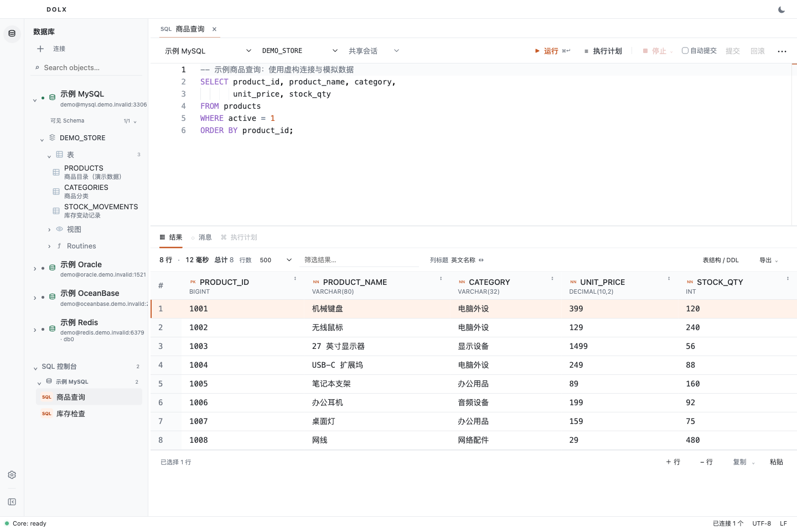
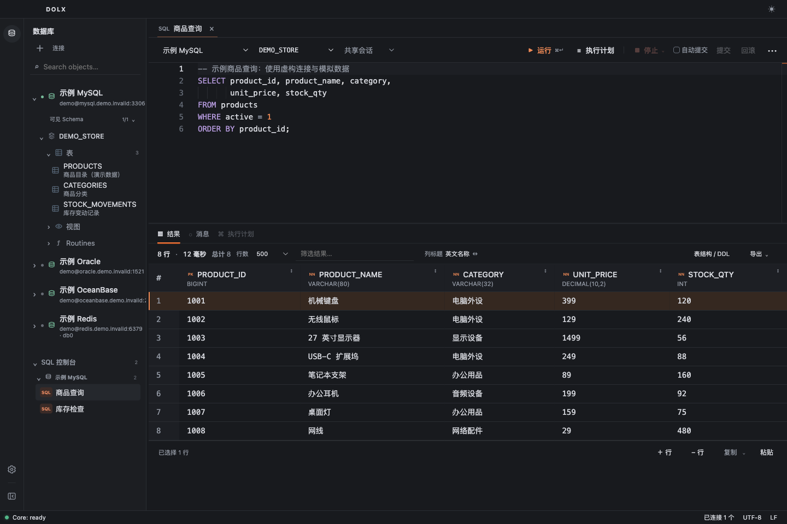
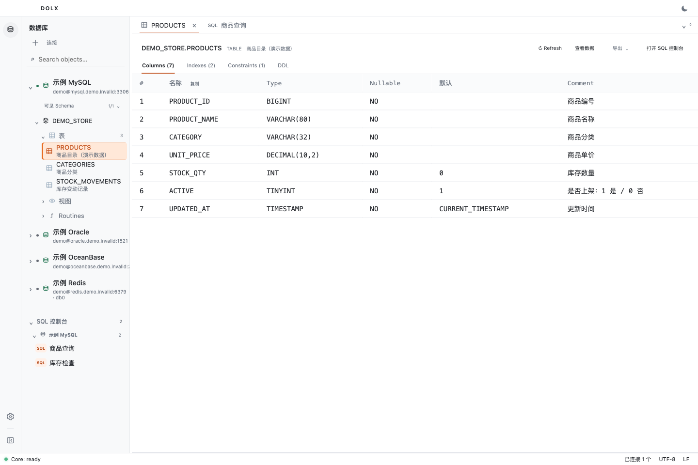
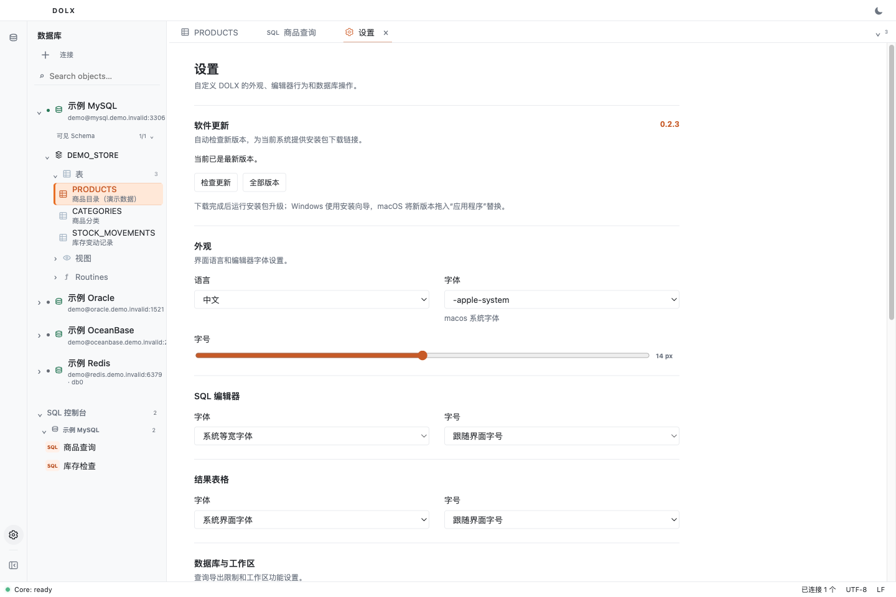

# DOLX

DOLX 是一款面向 Windows 和 macOS 的桌面数据库开发工具，将连接管理、SQL 编写、数据查询、对象结构查看和事务操作集中在同一个工作区。支持 Oracle、OceanBase Oracle、MySQL、OceanBase MySQL 和 Redis，适合日常开发、数据排查与数据库维护。

本仓库提供公开安装包、版本说明和界面预览。

## 下载与系统要求

[Windows 0.2.15 版本说明](https://github.com/niujt/DOLX-Releases/releases/tag/v0.2.15) · [macOS 0.2.13 版本说明](https://github.com/niujt/DOLX-Releases/releases/tag/v0.2.13) · [全部版本](https://github.com/niujt/DOLX-Releases/releases)

| 系统 | 最新版本 | 安装包 | 安装方式 |
| --- | --- | --- | --- |
| Windows 10 / 11，x64 | 0.2.15 | [下载 Windows 安装版](https://github.com/niujt/DOLX-Releases/releases/download/v0.2.15/DOLX-Setup-0.2.15-Windows-x64.exe) | 运行安装向导 |
| macOS 14 及以上，Apple Silicon（arm64） | 0.2.13 | [下载 macOS DMG](https://github.com/niujt/DOLX-Releases/releases/download/v0.2.13/DOLX-0.2.13-macOS-arm64.dmg) | 将 DOLX 拖入「应用程序」 |

安装包内置数据库服务和 Java 运行环境。校验值见各版本附带的 SHA-256 文件。macOS 安装包支持 NeoDesk 内嵌，签名情况见该版本发布说明。

## 主要功能

- **多数据库连接**：管理 Oracle、OceanBase、MySQL 和 Redis 数据源，切换 Schema，设置连接颜色和只读模式；Redis 支持 ACL、Database index 和 TLS。
- **SQL 编辑与执行**：多标签页、语法高亮、表名和字段补全、当前语句或选区执行、脚本运行、执行计划、方言参考及已保存控制台。
- **对象与元数据**：过滤和搜索数据库对象，查看列、注释、索引、约束与 DDL；对象列表优先展示，较慢的元数据在后台补充。
- **查询结果**：分页、当前页过滤、多行或整列选择、复制，以及 CSV / Excel / JSON / INSERT SQL 导出。Excel 支持重新查询并流式导出全部结果，其余格式导出当前加载页。
- **数据编辑与事务**：可编辑结果支持修改、新增和删除，需可靠主键或唯一键；支持自动提交、提交、回滚，以及共享或独立会话。
- **Oracle PL/SQL 开发**：源码查看、编辑、编译、断点调试、单步执行和变量查看，需数据库支持及相应权限。
- **Redis 控制台**：命令执行、结果查看、命令参考、参数提示和错误说明。
- **外观与配置迁移**：深浅主题、字体设置、侧边栏收展和动效；连接凭据使用系统安全存储，支持加密配置备份与迁移。
- **软件更新**：自动检查稳定版本，显示提醒并提供对应平台的安装包链接，也可在设置或帮助菜单中手动检查。

具体对象类型、编辑与调试能力取决于数据库类型、版本和账号权限。

## 界面预览

以下截图来自 0.2.3。截图中的连接地址、账号、SQL 和商品数据全部为虚构示例，不含真实环境信息；查询耗时和行数不作为性能指标。

### SQL 编辑与查询结果 · 极简浅色主题

### SQL 编辑与查询结果 · 深色主题

### 表结构与对象详情 · 浅色主题

### 软件更新与外观设置

## 升级

升级前保存 SQL，处理未提交事务并退出应用。Windows 运行新安装包；macOS 将新版本拖入“应用程序”并替换。

可从上表选择对应平台的安装包，也可以在 DOLX 设置中检查适用于当前平台的稳定版本。
