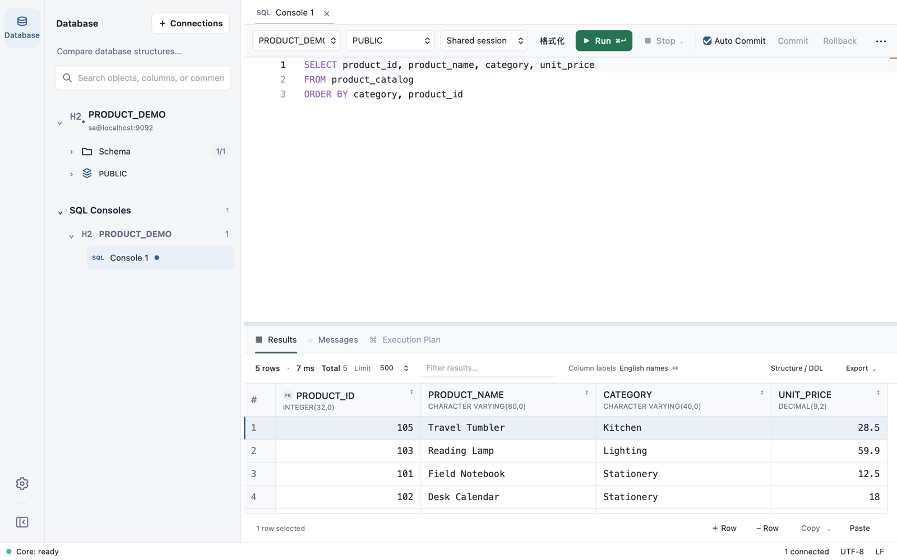
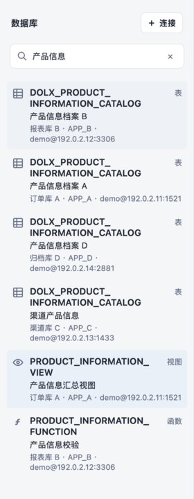
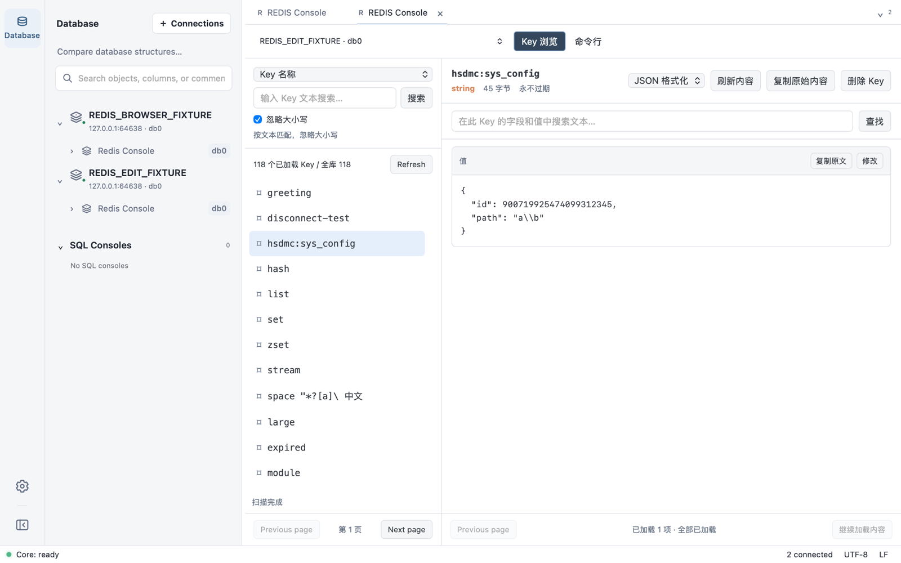

# DOLX

DOLX 是面向 Windows 和 macOS 的桌面数据库开发工具。在同一个工作区管理连接、编写和执行 SQL、查看结构、编辑数据与处理事务。macOS 也支持在 NeoDesk 中内嵌使用。

## 下载与系统要求

[发布说明与下载](https://github.com/niujt/DOLX-Releases/releases/tag/v0.2.19) · [全部版本](https://github.com/niujt/DOLX-Releases/releases)

| 系统 | 最新版本 | 安装包 | 安装方式 |
| --- | --- | --- | --- |
| Windows 10 / 11，x64 | 0.2.19 | [下载 Windows 安装版](https://github.com/niujt/DOLX-Releases/releases/download/v0.2.19/DOLX-Setup-0.2.19-Windows-x64.exe) | 运行安装向导 |
| macOS 14 及以上，Apple Silicon（arm64） | 0.2.13 | [下载 macOS DMG](https://github.com/niujt/DOLX-Releases/releases/download/v0.2.18/DOLX-0.2.13-macOS-arm64.dmg) | 将 DOLX 拖入「应用程序」 |

安装包内置数据库服务和 Java 运行环境。校验值见各版本附带的 SHA-256 文件。macOS 安装包支持 NeoDesk 内嵌，签名情况见该版本发布说明。

## 核心功能

- **SQL 开发工作台** 支持多标签、草稿恢复、表名与字段补全、SQL 格式化、命名参数和执行计划。结果可分页、编辑，并导出为 Excel、CSV、JSON 或 INSERT SQL。
- **跨连接对象搜索** Windows 版在已连接的数据库及所选 Schema 中搜索表、视图、字段和例程，直接列出命中的对象及其来源。在 SQL 控制台连按三次 Shift 可按名称、注释或简写查找。
- **跨库结构对比** 支持 Oracle 与 OceanBase Oracle、MySQL 与 OceanBase MySQL 在各自兼容模式内对比结构，生成可预览和保存的增量 SQL。
- **多数据源支持** 可连接 Oracle、MySQL、OceanBase、SQL Server、达梦、SQLite 和 H2。Redis 提供 Key 搜索与值编辑，Kafka、RabbitMQ、ZooKeeper 和 MongoDB 提供专用控制台。
- **Oracle 调试与数据库 MCP** 支持 PL/SQL 源码、断点和单步调试。Windows 可通过 DeepSeek Harness 使用数据库 MCP，访问范围可细化到连接、表和字段。

具体操作取决于数据库类型、版本和账号权限。

## 界面预览

截图使用演示数据。

### SQL 编辑与查询结果

### 数据库对象搜索

### Redis Key 浏览

